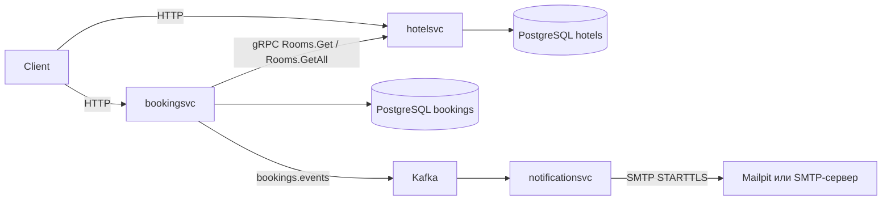

# Room Reservation System

Go-сервисы для управления отелями и номерами, бронирования и отправки уведомлений. Основной сценарий запускается через Docker Compose. После запуска можно создать отель и номер, оформить и отменить бронь, увидеть письма в Mailpit и проследить оба запроса до SMTP в Jaeger.

## Сервисы и связи

| Компонент | Назначение |
| --- | --- |
| `hotelsvc` | CRUD отелей и номеров по HTTP. Предоставляет данные о номерах по gRPC, хранит их в PostgreSQL `hotels-db`. |
| `bookingsvc` | REST API бронирований на chi и ogen. Читает данные номеров из `hotelsvc` по gRPC, хранит брони в PostgreSQL `bookings-db`, публикует события в Kafka. |
| `notificationsvc` | Читает Kafka и отправляет письма на настроенный SMTP-адрес получателя. Из HTTP предоставляет `/metrics`. |
| `sso` | Отдельный gRPC-сервис регистрации, входа и проверки флага администратора. Использует SQLite и выдаёт JWT. Запускается отдельно, Compose его не поднимает. |
| `protos` | Go-модуль с protobuf-контрактами и сгенерированными клиентами и серверами. Самостоятельного процесса нет. |



Создание брони проверяет номер в `hotelsvc` и пересечение дат с активными бронями, затем рассчитывает стоимость, сохраняет запись и публикует `booking.created`. Отмена переводит активную бронь в `cancelled` и публикует `booking.cancelled`. Ключ Kafka-записи — ID бронирования. Consumer группы `notificationsvc` обрабатывает записи и подтверждает offsets после обработки пачки. Для `booking.created` предусмотрено до трёх SMTP-попыток при временных ошибках, для `booking.cancelled` — одна попытка на обработку записи.

HTTP API принимает `user_id` как число из запроса. Связи с SSO, проверки токена и обработки оплаты в этом сценарии пока нет. Запись в PostgreSQL и публикация в Kafka выполняются последовательно, поэтому при ошибке Kafka изменение в БД уже может быть сохранено.

## Запуск с нуля

Понадобятся Docker Engine или Docker Desktop с Linux-контейнерами, Docker Compose v2 и терминал Bash. Для примеров нужны `curl`, `openssl` и Python 3. В Windows команды можно выполнять в WSL с включённой интеграцией Docker Desktop. Go для запуска Compose устанавливать не требуется.

Откройте корень репозитория. Первый запуск загрузит образы, соберёт сервисы и применит миграции двух PostgreSQL-баз. Начните с **Mailpit**. Это локальный SMTP-приёмник с веб-интерфейсом. Тестовые письма остаются в его почтовом ящике.

```bash
# Compose ожидает этот файл. touch сохраняет уже записанные настройки.
touch notificationsvc/.env

# Сертификат для STARTTLS. Храните каталог, пока используете этот стек.
export SMTP_TEST_CERT_DIR="$(mktemp -d)"
openssl req -x509 -newkey rsa:2048 -nodes -days 30 \
  -subj '/CN=smtp-test' -addext 'subjectAltName=DNS:smtp-test' \
  -keyout "$SMTP_TEST_CERT_DIR/key.pem" -out "$SMTP_TEST_CERT_DIR/cert.pem"

compose() {
  docker compose -f docker-compose.yml -f observability/compose.smtp-test.yml "$@"
}

compose config --quiet
compose up -d --wait kafka
compose exec -T kafka /opt/kafka/bin/kafka-topics.sh \
  --bootstrap-server kafka:29092 --create --if-not-exists \
  --topic bookings.events --partitions 1 --replication-factor 1
compose up -d --build --wait
compose ps -a
```

Оба контейнера миграций должны завершиться с кодом `0`. PostgreSQL, Kafka, Elasticsearch и Jaeger должны пройти healthcheck. При ошибке запуска откройте журналы конкретного сервиса, например `compose logs --tail=100 jaeger elasticsearch`.

| Адрес с хоста | Назначение |
| --- | --- |
| `http://localhost:8080`, `localhost:50051` | REST и gRPC `hotelsvc` |
| `http://localhost:8081/api/v1` | REST `bookingsvc` |
| `http://localhost:8082/metrics` | Метрики `notificationsvc` |
| `localhost:9092` | Kafka для клиентов на хосте. В Docker-сети используется `kafka:29092`. |
| [Prometheus](http://localhost:9090), [Grafana](http://localhost:3000) | Метрики и графики |
| [Jaeger](http://localhost:16686) | Трассировки |
| [Mailpit](http://localhost:8025) | Письма при запуске с тестовым override |
| `http://localhost:9308/metrics` | Kafka Exporter |

Для остановки используйте `compose stop`. Если конфигурация и контейнеры остались на месте, их можно поднять командой `compose start`. При пересборке `up --build` повторно подключает именованные volumes. Запускайте Compose с прежним именем проекта в том же каталоге. Флаг `down -v` удаляет volumes, включая базы, данные Kafka, метрики Prometheus, настройки Grafana и трассировки Elasticsearch.

### Внешний SMTP

Для работы с внешним SMTP заполните `notificationsvc/.env` значениями `SMTP_HOST`, `SMTP_PORT`, `SMTP_USER`, `SMTP_PASSWORD` и `SMTP_RECIPIENT`. Сервер должен поддерживать STARTTLS и SMTP PLAIN после установки TLS. Получатель берётся из конфигурации сервиса и одинаков для всех событий. Запуск через `docker compose up -d --build --wait` применяет основной файл Compose и включает отправку на настроенный адрес. Храните реальные данные доступа локально. Для проверки используйте вариант с Mailpit выше.

## HTTP API

### `hotelsvc` · порт 8080

| Метод и путь | Действие | Успех |
| --- | --- | --- |
| `POST /hotels` | Создать отель | `201` |
| `GET /hotels` | Получить список отелей | `200` |
| `GET /hotels/{id}` | Получить отель | `200` |
| `PUT /hotels/{id}` | Обновить отель | `204` |
| `DELETE /hotels/{id}` | Удалить отель | `204` |
| `POST /hotels/{hotel_id}/rooms` | Добавить номер | `201` |
| `GET /hotels/{hotel_id}/rooms` | Получить номера отеля | `200` |
| `GET /hotels/{hotel_id}/rooms/{room_id}` | Получить номер | `200` |
| `PUT /hotels/{hotel_id}/rooms/{room_id}` | Обновить номер | `204` |
| `DELETE /hotels/{hotel_id}/rooms/{room_id}` | Удалить номер | `204` |
| `GET /metrics` | Метрики Prometheus | `200` |

`POST` и `PUT` принимают JSON. Поля отеля — `name`, `address`, `rating`, `rooms_num`, `rooms_occupied`. Допустимый рейтинг — `0`, `3`, `4` или `5`. Поля номера — `room_num`, `type`, `cost`, `is_available`. Тип номера — `economic`, `standard` или `luxury`. Статусы номера в `hotelsvc` — `0` зарезервирован, `1` ожидает, `2` доступен. Текущий gRPC-клиент `bookingsvc` считает доступным любой ненулевой статус и дополнительно проверяет пересечение с активными бронями. Для тестовых данных используйте статус `2`.

DTO отелей и комнат не возвращают их ID, а создание отвечает пустым `201`. Ниже показано, как получить ID созданного отеля запросом только на чтение.

### `bookingsvc` · порт 8081

У бизнес-ручек общий префикс `/api/v1`. Даты передаются в формате `YYYY-MM-DD`, дата выезда должна быть позже даты заезда. Контракт находится в [booking.openapi.yaml](bookingsvc/api/openapi/booking.openapi.yaml).

| Метод и путь | Параметры | Успех |
| --- | --- | --- |
| `GET /api/v1/hotels/{hotel_id}/available-rooms` | Query: `date_from`, `date_to` | `200`, объект `rooms` с массивом доступных номеров |
| `POST /api/v1/bookings` | JSON: `user_id`, `hotel_id`, `room_id`, `date_from`, `date_to` | `201`, созданная бронь с ID, стоимостью за ночь, полной стоимостью и статусом |
| `GET /api/v1/bookings` | Query: `user_id` и/или `hotel_id`. Если переданы оба, применяются оба фильтра | `200`, объект `bookings` |
| `GET /api/v1/bookings/{booking_id}` | ID брони в пути | `200`, бронь |
| `DELETE /api/v1/bookings/{booking_id}` | ID активной брони в пути | `204`, статус меняется на `cancelled` |
| `GET /metrics` | — | `200`, метрики Prometheus |

Недоступный номер при создании даёт `409`. Чтение отсутствующей брони и отмена отсутствующей или уже отменённой брони дают `404`.

### `notificationsvc` · порт 8082

`GET /metrics` возвращает метрики consumer. Отправка уведомлений инициируется сообщениями `booking.created` и `booking.cancelled` в `bookings.events`.

## Проверка полного сценария

В том же Bash, где определена функция `compose`, создайте тестовый отель и номер.

```bash
hotel_name="Test hotel $(date +%s)"
curl -fsS -X POST http://localhost:8080/hotels \
  -H 'Content-Type: application/json' \
  -d "{\"name\":\"$hotel_name\",\"address\":\"Test address\",\"rating\":3,\"rooms_num\":1,\"rooms_occupied\":0}"

hotel_id="$(compose exec -T hotels-db psql -At -U booking -d hotels \
  -c "SELECT id FROM hotels WHERE name = '$hotel_name' ORDER BY id DESC LIMIT 1")"

curl -fsS -X POST "http://localhost:8080/hotels/$hotel_id/rooms" \
  -H 'Content-Type: application/json' \
  -d '{"room_num":101,"type":"standard","cost":1000,"is_available":2}'

python3 observability/verify_traces.py "$hotel_id"
```

Скрипт ищет свободный номер, создаёт бронь, читает список и отдельную запись, отменяет бронь и выводит пять TraceID. Затем он проверяет родительские связи через Jaeger Query API и наличие двух писем в [Mailpit](http://localhost:8025). Для отдельной ручной проверки без изменения данных выполните:

```bash
curl -fsS "http://localhost:8081/api/v1/bookings?hotel_id=$hotel_id"
```

## Метрики

Откройте [Prometheus → Targets](http://localhost:9090/targets). Через один-два интервала опроса по 15 секунд все пять целей должны перейти в `UP`. Сырые метрики приложений доступны по `/metrics` на портах 8080, 8081 и 8082, метрики Kafka Exporter — на 9308.

| Что проверить | Метрики |
| --- | --- |
| Количество HTTP-запросов и время ответа | `booking_http_requests_total`, `booking_http_request_duration_seconds`, аналоги с префиксом `hotel_` |
| gRPC между бронированием и отелями | `booking_grpc_client_requests_total`, `booking_grpc_client_duration_seconds`, `hotel_grpc_server_requests_total`, `hotel_grpc_server_duration_seconds` |
| Публикация событий | `booking_kafka_produce_total`, `booking_kafka_produce_duration_seconds` |
| Обработка и коммит offsets | `notification_kafka_messages_total`, `notification_kafka_handler_duration_seconds`, `notification_kafka_fetch_errors_total`, `notification_kafka_commits_total` |
| Брокер и отставание consumer | `kafka_brokers`, `kafka_consumergroup_lag` |

Примеры PromQL для вкладки Query в Prometheus или Explore в Grafana:

```promql
# Запросы по HTTP-методу, маршруту и статусу.
sum by (method, route, status) (rate(booking_http_requests_total[5m]))

# Среднее время ответа по маршруту и методу, в секундах.
sum by (method, route) (rate(booking_http_request_duration_seconds_sum[5m]))
/
sum by (method, route) (rate(booking_http_request_duration_seconds_count[5m]))

# p95 времени ответа в секундах.
histogram_quantile(0.95, sum by (le, method, route) (rate(booking_http_request_duration_seconds_bucket[5m])))

# Обработанные события по результату.
sum by (result) (increase(notification_kafka_messages_total[5m]))

# Отставание consumer по партициям.
kafka_consumergroup_lag{consumergroup="notificationsvc",topic="bookings.events"}
```

Сделайте несколько запросов и дождитесь минимум двух сборов метрик, прежде чем смотреть `rate`. В [Grafana](http://localhost:3000) на новом volume стандартный вход — `admin` / `admin`. Источник Prometheus подключается автоматически. Готовые дашборды в репозитории отсутствуют, запросы можно запускать в **Explore**.

## Трассировки и логи

`bookingsvc`, `hotelsvc` и `notificationsvc` отправляют spans через OTLP/HTTP в Jaeger v2. Jaeger читает и пишет трассировки в одноузловой Elasticsearch. В Compose задан `OTEL_EXPORTER_OTLP_ENDPOINT=http://jaeger:4318`, а `OTEL_SERVICE_NAME` задаёт имя сервиса. Локальный SDK записывает 100% трассировок. Запросы к `/metrics` не трассируются.

| HTTP-операция в Jaeger | Что искать под серверным span |
| --- | --- |
| `GetAvailableRooms` | `BookingService`, gRPC `Rooms.GetAll`, PostgreSQL обоих сервисов |
| `CreateBooking` | `BookingService`, gRPC `Rooms.Get`, PostgreSQL обоих сервисов, Kafka publish → process, `booking.created notify` → `SMTP send` |
| `GetBookings`, `GetBookingByID` | `BookingService` и запрос PostgreSQL |
| `CancelBooking` | `BookingService`, PostgreSQL, Kafka publish → process, `booking.cancelled notify` → `SMTP send` |

1. Сделайте HTTP-запрос и подождите несколько секунд, пока spans попадут в хранилище.
2. В [Jaeger UI](http://localhost:16686) выберите **Service → bookingsvc**, нужную операцию и **Find Traces**. По известному ID можно открыть `http://localhost:16686/trace/<trace_id>`. JSON доступен через `/api/traces/<trace_id>`.
3. Чтобы сопоставить trace с журналом, выполните `compose logs bookingsvc notificationsvc | grep '<trace_id>'`. Связанные записи `slog` содержат `trace_id` и `span_id`.

Скрипт `verify_traces.py` отправляет искусственный `traceparent` для проверки передачи контекста. Jaeger может пометить эти трассировки как **Incomplete**, поскольку клиентский родительский span существует только как ID в заголовке. Обычный запрос без этого заголовка создаёт корневой HTTP-span в `bookingsvc`.

Длительность родительского span включает время дочерних операций, поэтому вложенные интервалы не складываются. HTTP-ответ может завершиться раньше SMTP. Для статистики времени ответа используйте гистограмму Prometheus. Коннектор `spanmetrics` для вкладки Jaeger **Monitor** в проекте пока не настроен.

## gRPC API

### Номера · `localhost:50051`

Контракт — [rooms.proto](protos/proto/hotelsvc/rooms/rooms.proto). `rooms.Rooms/GetAll` принимает `hotelID` и возвращает номера отеля. `rooms.Rooms/Get` принимает `hotelID` и `roomID` и возвращает один номер. Reflection не включён. Для ручного вызова передайте контракт в `grpcurl`:

```bash
grpcurl -plaintext -import-path protos/proto \
  -proto hotelsvc/rooms/rooms.proto -d "{\"hotelID\":$hotel_id}" \
  localhost:50051 rooms.Rooms/GetAll
```

### SSO · `localhost:44044`

Контракт — [sso.proto](protos/proto/sso/sso.proto).

| RPC | Запрос и результат |
| --- | --- |
| `auth.Auth/Register` | `email`, `password` → `user_id` |
| `auth.Auth/Login` | `email`, `password`, `app_id` → JWT. Для `app_id` нужна запись в SQLite-таблице `apps`. |
| `auth.Auth/IsAdmin` | По контракту `user_id` → `is_admin`. На чистой базе RPC сейчас возвращает `Internal`: запрос читает столбец `admin`, а миграция создаёт `is_admin`. |
| `auth.Auth/Logout` | Объявлен в контракте. Отзыв токена в текущей реализации отсутствует. |

Для отдельного запуска SSO нужны Go 1.25.5 или новее, C-компилятор для SQLite-драйвера и, для примера входа, `sqlite3` и `grpcurl`. Команды используют временную SQLite-базу.

```bash
cd sso
sso_dir="$(mktemp -d)"
cat > "$sso_dir/config.yaml" <<EOF_CONFIG
env: local
storage_path: "$sso_dir/sso.db"
grpc:
  port: 44044
EOF_CONFIG
CGO_ENABLED=1 go run ./cmd/migrator \
  -storage-path="$sso_dir/sso.db" -migrations-path=./migrations
sqlite3 "$sso_dir/sso.db" \
  "INSERT INTO apps (id, name, secret) VALUES (1, 'local-test', '$(openssl rand -hex 32)');"
CGO_ENABLED=1 go run ./cmd/sso -config="$sso_dir/config.yaml"
```

В другом терминале из корня проекта:

```bash
grpcurl -plaintext -import-path protos/proto -proto sso/sso.proto \
  -d '{"email":"demo@example.test","password":"local-demo-password"}' \
  127.0.0.1:44044 auth.Auth/Register

grpcurl -plaintext -import-path protos/proto -proto sso/sso.proto \
  -d '{"email":"demo@example.test","password":"local-demo-password","appId":1}' \
  127.0.0.1:44044 auth.Auth/Login

# Подставьте ID из ответа Register. На чистой базе ожидается Internal.
grpcurl -plaintext -import-path protos/proto -proto sso/sso.proto \
  -d '{"userId":1}' 127.0.0.1:44044 auth.Auth/IsAdmin
```

## Если проверка не проходит

| Симптом | Что проверить |
| --- | --- |
| Compose сообщает, что `notificationsvc/.env` отсутствует | Создайте файл командой `touch notificationsvc/.env`. Для Mailpit достаточно пустого файла. |
| Порт занят | Проверьте, что запускаете прежний Compose-проект и порт не использует другой контейнер или процесс. |
| Kafka или Jaeger не проходят healthcheck | Посмотрите `compose ps -a` и `compose logs --tail=100 kafka elasticsearch jaeger`. |
| Запросы к localhost идут через прокси | Добавьте `localhost,127.0.0.1` к `NO_PROXY` и `no_proxy` в терминале, из которого запускаете проверку. |
| SMTP сообщает об истёкшем сертификате или неизвестном CA | Сгенерируйте новый тестовый сертификат по инструкции запуска и снова выполните `compose up -d --wait` с новым `SMTP_TEST_CERT_DIR`. |
| В Jaeger ещё нет spans | Сделайте запрос к бизнес-ручке, подождите несколько секунд и проверьте `compose logs --tail=100 bookingsvc jaeger`. |

## Сборка и структура репозитория

У приложения отдельные Go-модули. Для локальной сборки всего кода используйте Go 1.26 или новее. Модулю SSO нужен CGO с C-компилятором, как в примере выше.

```bash
set -e
for module in bookingsvc hotelsvc notificationsvc protos; do
  (cd "$module" && go build ./... && go test ./...)
done
(cd sso && CGO_ENABLED=1 go build ./...)
```

У `sso` обычный `go test ./...` сейчас останавливается на проверке `go vet` из-за вызовов `slog` с непарными аргументами в [auth.go](sso/internal/services/auth/auth.go). Для запуска сервиса используйте команды из раздела SSO.

Конфигурации приложений лежат в `*/config/`, схемы PostgreSQL — в `hotelsvc/migrations/` и `bookingsvc/migrations/`, SQLite — в `sso/migrations/`. Контракт бронирований и сгенерированный ogen-сервер находятся в `bookingsvc/api/` и `bookingsvc/internal/gen/`, protobuf — в `protos/proto/`, настройки Prometheus, Grafana, Jaeger и тестового SMTP — в `observability/`.
